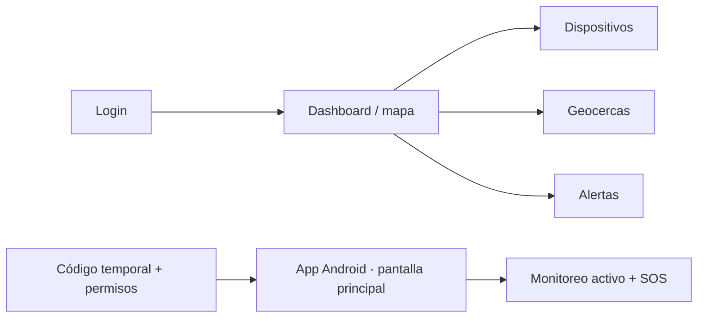

# Diseño funcional y pantallas — Kivo MVP

Requisitos y aceptación: [especificación central aprobada](../docs/superpowers/specs/2026-11-08-kivo-mvp-design.md). Las recomendaciones P-01 a P-11 quedan adoptadas como base de diseño; los refinamientos técnicos abiertos deben cerrarse antes de implementar el comportamiento afectado.

## Roles

- **Administrador escolar:** registra estudiantes ficticios para demo, dispositivos, geocercas y usuarios.
- **Operador:** consulta mapa y atiende alertas.
- **App Android:** sesión vinculada y autorizada, no acceso administrativo.

## Pantallas mínimas

| Pantalla | Elementos | Acción principal |
|---|---|---|
| Inicio de sesión | Credenciales, errores | Acceder |
| Dashboard | Mapa, marcadores, última actualización, estado | Ver dispositivos |
| Dispositivos | Lista, identificador, estudiante asociado, estado, código temporal | Vincular teléfono / finalizar sesión |
| Geocercas | Mapa, centro, radio, nombre, dispositivos asignados | Guardar y asignar zona |
| Alertas | Tipo, severidad, hora, estado | Reconocer alerta |
| Vinculación Android | Código temporal de un solo uso y permisos necesarios | Vincular teléfono |
| Principal Android | Estado del seguimiento, iniciar/detener y SOS | Enviar ubicación durante la sesión |

## Navegación

## Reglas UX

- Marcador indica **última ubicación reportada**, no posición exacta en vivo.
- Mostrar `última actualización`, precisión GPS y estado conectado/desactualizado.
- No mostrar rutas de menores a personas no autorizadas.
- SOS con confirmación visual de recepción; no prometer atención inmediata.
- Dashboard responsive; controles grandes en Android y estado de permisos visible.
- Implementar el dashboard con **Next.js + PrimeReact**; usar **mapcn** para el mapa, los marcadores y la representación de geocercas.
- Diseñar pantallas y flujos en **Google Stitch**, tomando los componentes PrimeReact como referencia del dashboard.

## Simplicidad de Android

Propuesta de navegación: vinculación inicial y luego una sola pantalla principal, sin menús administrativos, tablas ni mapas. Mostrar el estado del seguimiento, una acción de iniciar/detener y SOS. Presentar los permisos solo cuando sean necesarios y ofrecer una acción clara cuando impidan el seguimiento.

Durante una sesión autorizada, bloquear la pantalla o abrir otra app no debe detener por sí solo el envío de ubicación. Mostrar una notificación de seguimiento activo y detener la captura al finalizar la sesión. La app se implementará con Flutter y Dart para Android.

El administrador selecciona al estudiante ficticio y genera un código temporal de un solo uso para ingresarlo en Android. Vincular no inicia el monitoreo ni exige una cuenta al estudiante. Android inicia y detiene; el personal escolar puede finalizar la sesión. El máximo inicial es de 8 horas, configurable.

SOS está disponible también sin sesión activa para un teléfono vinculado y habilitado. No inicia seguimiento continuo; puede adjuntar una ubicación puntual autorizada, sin esperar GPS para enviar. Mostrar enviando, enviado sin acuse, recibido por servidor y error/reintentar; la recepción técnica no acredita atención humana.

Sin conexión, mantener la última posición pendiente y los SOS. Mostrar que no llegaron al servidor; al finalizar la sesión descartar la posición pendiente. Las zonas se asignan por dispositivo y se evalúan independientemente. No agregar una acción de atender o resolver alertas en este borrador; el contrato propuesto solo contempla reconocerlas.

## Flujo de diseño

1. Definir en Stitch el dashboard y la navegación entre dispositivos, geocercas y alertas.
2. Diseñar por separado la vinculación y pantalla mínima Android para su implementación en Flutter.
3. Revisar estados de carga, error, falta de permisos, ausencia de datos y confirmación SOS.
4. Validar los diseños antes de implementar; usar PrimeReact en la web y adaptar el mapa con mapcn.
