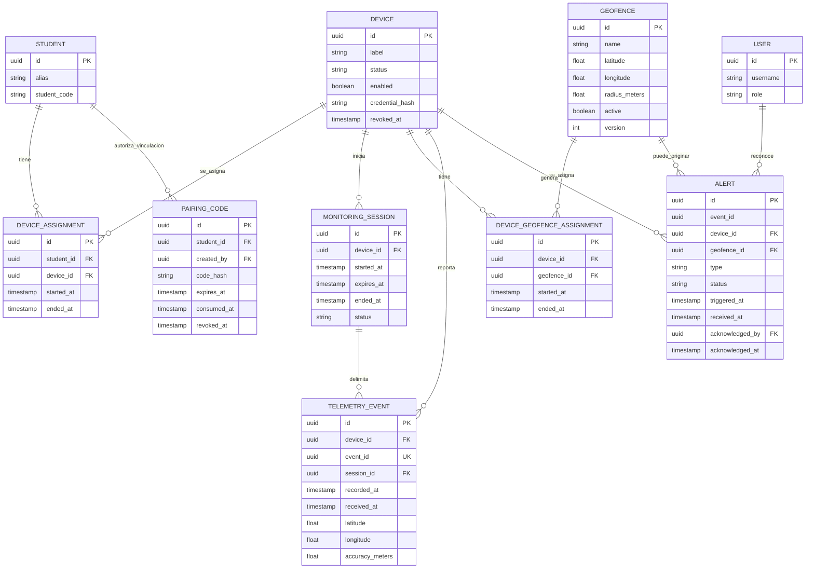

# Modelo de datos mínimo

La [spec central](../docs/superpowers/specs/2026-11-08-kivo-mvp-design.md) define acuerdos y retención. Los campos nuevos, cardinalidades técnicas y estados de este modelo son propuestas P-02/P-08/P-11, no migraciones implementadas.

## Entidades

## Persistencia

- `telemetry_events`: histórico limitado con índice `(device_id, recorded_at DESC)` y `UNIQUE(event_id)`.
- `device_latest_position`: snapshot durable por `device_id` para reconstruir Redis.
- `geofence_state`: estado lógico por dispositivo y geocerca, recuperable desde Kafka Streams o snapshot.
- `alerts`: incluir `acknowledged_by` y `acknowledged_at`. `resolved_at` se excluye de este borrador porque no existe flujo ni contrato de resolución. Propuesta P-07: SOS se persiste antes del acuse; una salida de zona mantiene el camino asíncrono.
- `audit_log`: acciones sensibles y accesos a ubicaciones.
- `monitoring_sessions`: delimita cuándo se permite rastreo.
- No guardar nombres completos reales de menores en demos. Retención acordada: ubicaciones 7 días; alertas y auditoría 30 días. Una coordenada adjunta a SOS expira a los 7 días aunque sobreviva la alerta. Snapshots, Redis y logs no deben prolongar la ubicación.

## Reglas adicionales propuestas

- Código de un solo uso: no almacenar el código en texto plano; consumo y asignación en la misma transacción. Una asignación vigente por teléfono, conservando historial de reasignaciones sin atribuir posiciones antiguas al nuevo estudiante.
- `monitoring_sessions`: una sesión abierta por teléfono; `expires_at` fija el máximo vigente al iniciar, con 8 horas como valor inicial. Registrar quién finalizó y el motivo. Distinguir autoridad servidor de pausa local Android.
- Credencial limitada por dispositivo: almacenamiento protegido; mecanismo de emisión, renovación y revocación pendiente de diseño técnico. No exponer el hash en API.
- `device_geofence_assignments`: evitar duplicados vigentes `(device_id, geofence_id)` y versionar cambios efectivos; el estado procesado debe incorporar esa versión de asignación además de la versión de zona y `sessionId`. Inicializar estado por sesión sin comparar posiciones de sesiones distintas (P-08).
- Unicidad SOS por `(device_id, event_id)`; para salidas derivadas usar identidad estable por evento fuente, zona y versión, evitando colisión cuando un evento afecta varias zonas. Un reintento no duplica alertas.
- Ubicación SOS opcional: tabla/relación separable con `recorded_at` y precisión para borrar a los 7 días sin borrar la alerta de 30 días. No copiar coordenadas en auditoría ni textos de alerta.
- Las alertas y snapshots deben conservar referencia a la asignación o contexto histórico del dispositivo para que una reasignación no cambie el estudiante al que pertenecía el evento.
- Implementar retención en todos los almacenes; P-09/P-10 de la spec aún deben resolver horarios, segmentos Kafka, changelogs y backups. Borrado lógico en consultas no sustituye borrado físico.

## Migraciones con Flyway

Gestionar el esquema PostgreSQL mediante migraciones SQL versionadas de Flyway en el backend Quarkus. Cuando se cree el módulo, usar `src/main/resources/db/migration/` y nombres como `V1__initial_schema.sql` y `V2__add_alert_index.sql`.

No modificar migraciones ya aplicadas: agregar una nueva para cada cambio. Validar creación desde cero y actualización desde la versión anterior. Los datos ficticios de demostración deben mantenerse separados de las migraciones del esquema de producción.

Referencia: [Flyway en Quarkus](https://quarkus.io/guides/flyway/).
