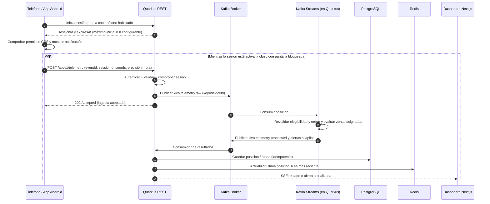

# Flujo de telemetría GPS

Requisitos RF-03 a RF-07 y propuestas P-03/P-08 en la [spec central](../docs/superpowers/specs/2026-11-08-kivo-mvp-design.md). El diagrama incorpora la propuesta de `sessionId` y revalidación al procesar.

**Semántica:** `202 Accepted` significa que la API aceptó la publicación, **no** que la alerta ya fue persistida ni visualizada. Para minimizar pérdidas entre Kafka y BD, usar consumidores idempotentes y política de reintentos; en una fase posterior evaluar patrón outbox según necesidades.

## Reglas de validación

- Posición recibida solo con sesión de monitoreo activa y credencial autorizada.
- `accuracyMeters` excesivo: mostrar posición aproximada, no disparar transición de zona.
- No procesar para última posición eventos antiguos o duplicados.
- La batería es **opcional**; su captura depende de la implementación Android.
- SSE puede desconectarse; el dashboard recupera estado por REST al reconectar.
- Sin red, sustituir la posición pendiente por la más reciente; reintentar con el mismo `eventId` y `sessionId` si la sesión sigue autorizada. Al finalizar o vencer, detener captura y descartar posición pendiente.
- Propuesta P-08: evento aceptado en Kafka pero no elegible tras cerrar sesión no actualiza monitoreo. `202` no garantiza que llegue a aplicarse.
- El cierre remoto depende de sincronización; sin red no prometer recepción instantánea. El servidor rechaza posiciones de sesiones cerradas y Android respeta el vencimiento que ya conoce.
