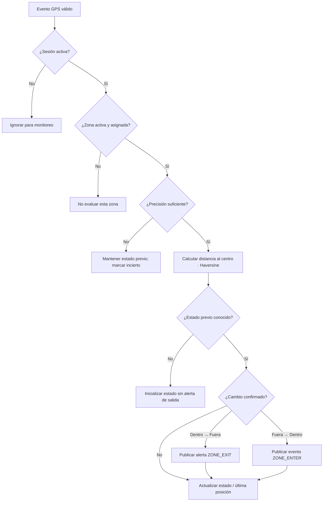

# Flujo de geocerca y zona segura

Para el MVP: una o varias zonas circulares, definidas por centro (latitud, longitud) y radio en metros.

El administrador asigna zonas por dispositivo y cada zona se evalúa por separado: estar dentro de B no evita una salida de A. Requisitos RF-08/RF-09 y propuestas P-05/P-08 en la [spec central](../docs/superpowers/specs/2026-11-08-kivo-mvp-design.md).

## Antirruido GPS

- Umbral de entrada y salida con **histéresis** (p. ej., radio ± 20 m, configurable).
- Confirmar una transición con 2 mediciones consecutivas confiables; valores de prueba, ajustar en campo.
- No alertar por ausencia de GPS: marcar dispositivo como *sin posición reciente*.
- No confundir falta de conectividad con salida de geocerca.

## Estado en Kafka Streams

Clave `deviceId:geofenceId`, valor `{inside, lastRecordedAt, consecutiveConfirmations, zoneVersion}`. El estado se conserva en una store local de Kafka Streams respaldada por changelog; no depende de Redis.

Propuesta P-08: incluir `sessionId` y versión de asignación además de `zoneVersion`. Al comenzar cada sesión, reinicializar los estados del dispositivo y usar su primera posición confiable como referencia sin alerta de salida. No comparar contra la sesión anterior: terminar dentro e iniciar otra fuera no constituye una salida observada durante monitoreo. Al editar centro/radio o asignar nuevamente una zona, reinicializar solo el estado afectado sin salida artificial. Eventos duplicados o anteriores no retroceden el estado ni duplican alertas. Un teléfono sin zonas asignadas sigue pudiendo reportar y enviar SOS.
