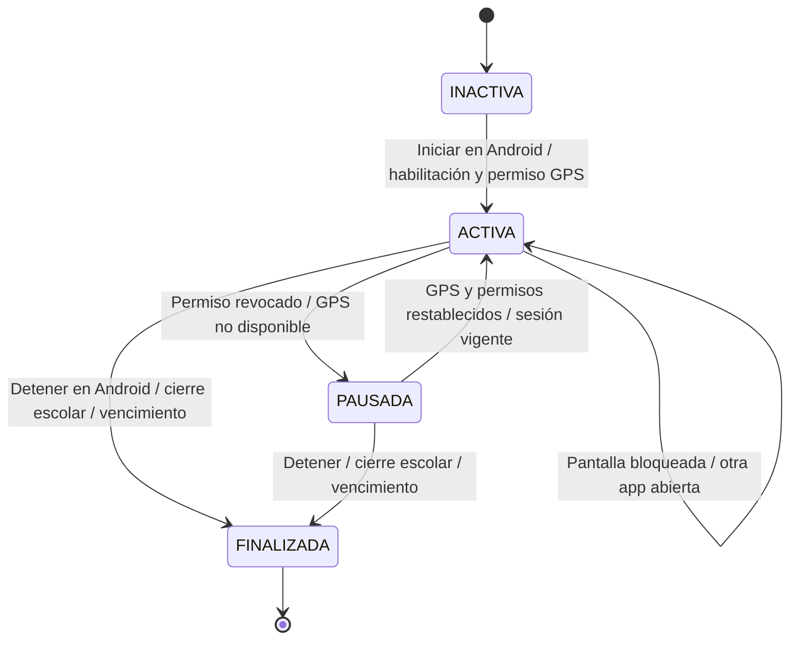
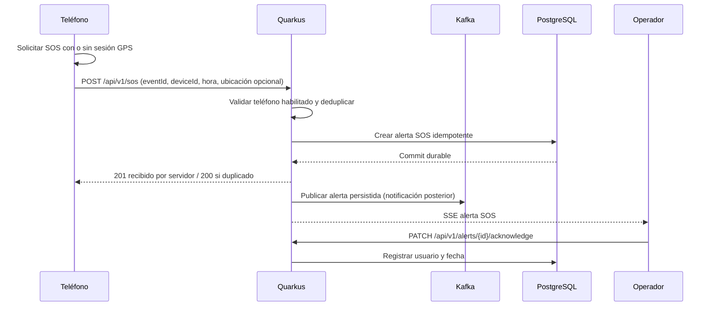

# Sesión de monitoreo, SOS y desconexión

Acuerdos RF-03/RF-06/RF-10/RF-11 en la [spec central aprobada](../docs/superpowers/specs/2026-11-08-kivo-mvp-design.md). La sincronización de cierre remoto y persistencia SOS corresponden a P-03/P-07/P-08, adoptadas como base de diseño con la aprobación del propietario; los detalles técnicos expresamente abiertos requieren refinamiento.

## Sesión

La app Android debe mantener el seguimiento durante una sesión autorizada con pantalla bloqueada o al usar otra aplicación. Esto requiere permisos e integración con los mecanismos de ejecución Android; la app se implementará con Flutter y Dart. Una detención forzada, falta de red o restricciones del sistema pueden interrumpir los reportes. El servidor deduce el estado **sin comunicación** por la antigüedad del último evento; no supone que el niño esté fuera de una zona.

## SOS

El administrador habilita el teléfono mediante código temporal. Android inicia/detiene sesiones y el personal escolar puede finalizarlas. Máximo inicial de 8 horas configurable; pausar no amplía el límite. Sin red, conservar solo la última posición pendiente y los SOS; al cerrar o vencer descartar la posición pendiente. El cierre remoto requiere comunicación; la app respeta el vencimiento conocido y el servidor rechaza telemetría de sesiones cerradas.

**Propuesta P-07:** el diagrama muestra el camino exitoso con persistencia directa antes del acuse. Si BD no confirma, no afirmar recepción; timeout permite reintentar el mismo `eventId`. Kafka/SSE posteriores pueden fallar sin perder la alerta durable, recuperable por REST. El contrato propone refresco REST para detectar estas alertas aunque SSE no se desconecte.

El SOS requiere teléfono vinculado y habilitado, pero no sesión GPS activa. Ubicación puntual opcional y autorizada; no esperar GPS ni iniciar seguimiento continuo. Reintentar no captura ubicaciones nuevas. Un SOS pendiente puede enviarse después de terminar la sesión, mostrando su hora original; límite y caducidad de cola quedan propuestos.

Estados Android: enviando, enviado sin acuse, recibido por servidor y error/reintentar. Recibido solo significa persistencia del servidor. Reconocer registra usuario y fecha; no acredita atención. Propuesta de alertas: pendiente y reconocida, sin acción de resolver/atender.

**Aviso:** “SOS solicita ayuda; no llama a emergencias ni garantiza atención inmediata.”

## Desconexión

- Si `now - lastSeenAt` supera el umbral (ej. 60 segundos), marcar **sin comunicación**.
- Puede ser falta de red, batería, permisos o detención de la app o restricciones del sistema Android.
- Mostrar último timestamp y **no afirmar** ubicación actual.
