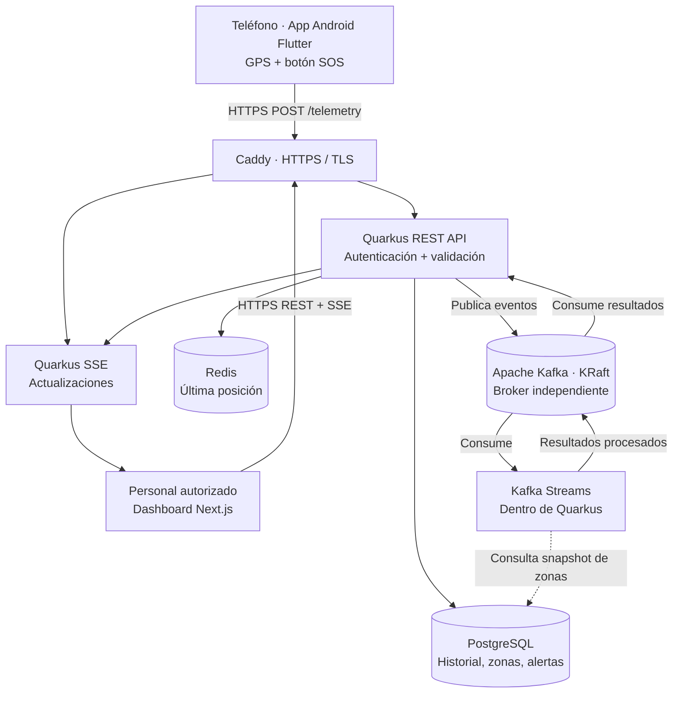

# Arquitectura general — Kivo MVP

## Objetivo

Monitorear ubicaciones GPS de teléfonos durante sesiones autorizadas, identificar salidas de una zona segura circular y mostrar alertas SOS en un dashboard escolar.

La [especificación central aprobada](../../codebase/backend/docs/superpowers/specs/2026-11-08-kivo-mvp-design.md) consolida requisitos y decisiones de diseño, con refinamientos técnicos abiertos. El MVP es una demo con datos ficticios para un colegio.

## Decisiones de alcance

- **Un solo colegio** como alcance del MVP.
- **Next.js + PrimeReact** para el dashboard web y **mapcn** para mapas.
- **App Android instalada, desarrollada con Flutter y Dart**, con interfaz mínima y seguimiento durante sesiones autorizadas incluso con pantalla bloqueada o al usar otra aplicación.
- **Google Stitch** para diseñar pantallas y flujos; PrimeReact como referencia visual y de componentes del dashboard.
- **Quarkus LTS + Java 25 LTS** como monolito modular REST, por instrucción posterior del propietario al crear el esqueleto.
- **Apache Kafka** como broker separado y **Kafka Streams embebido como librería en Quarkus**.
- **PostgreSQL** como fuente de verdad, con **Flyway** para migraciones versionadas. **Redis** para la última posición (caché reconstruible).
- **PostGIS** es opcional: en MVP las geocercas son círculos con distancia Haversine, con tolerancia por precisión GPS.
- **SSE** del backend al dashboard; REST desde el teléfono.
- **Docker Compose** en un VPS único; sin Kubernetes.
- **Resilience4j fuera del alcance inicial**; evaluar SmallRye Fault Tolerance solo si surge una dependencia que lo requiera.

## Diagrama de componentes

**Nota de implementación:** las flechas son lógicas. API, procesador Streams y SSE pueden residir en **un único proceso Quarkus**. La persistencia de eventos procesados y actualización de caché la realiza un consumidor dentro de Quarkus, no el broker directamente.

## Límites operativos

- Una sola instancia Kafka KRaft y un solo VPS **no ofrecen alta disponibilidad**.
- El dashboard indica hora de última posición y estado *desactualizado* si expira el umbral de comunicación.
- El teléfono no se monitorea fuera de la sesión autorizada.
- Un SOS solicitado puede adjuntar ubicación puntual autorizada sin sesión; no inicia monitoreo continuo. El teléfono debe estar vinculado y habilitado.
- La vinculación usa código temporal de un solo uso generado por el administrador. Sesiones iniciadas/detenidas desde Android y finalizables desde el colegio; máximo inicial configurable de 8 horas.
- Geocercas asignadas por dispositivo y evaluadas independientemente. Sin red, Android conserva la última posición pendiente y los SOS; una posición pendiente se descarta al finalizar su sesión.
- La batería es un dato opcional en el contrato; su lectura se definirá durante la implementación Flutter para Android.

## Seguimiento Android

La app debe mantener la captura y el envío durante la sesión aunque su pantalla no esté visible. La implementación deberá contemplar un servicio de ubicación en primer plano, notificación visible y permisos adecuados a la versión Android; no se promete continuidad tras una detención forzada o revocación de permisos. Se usará Flutter con Dart; la integración con los mecanismos Android se definirá y validará durante la implementación.

Referencia: [ubicación y permisos en Android](https://developer.android.com/develop/sensors-and-location/location/permissions).

## Propuesta de recepción SOS

A diferencia de la ingesta asíncrona de telemetría, persistir idempotentemente el SOS directamente en PostgreSQL antes de confirmar recepción al teléfono. La publicación Kafka y notificación SSE ocurren después; su falla no revierte una recepción ya persistida. Las lecturas REST recuperan las alertas durables, sin prometer notificación inmediata. Este camino corresponde a P-07, adoptada con la aprobación de la spec; el diagrama de componentes representa principalmente el procesamiento de telemetría.
