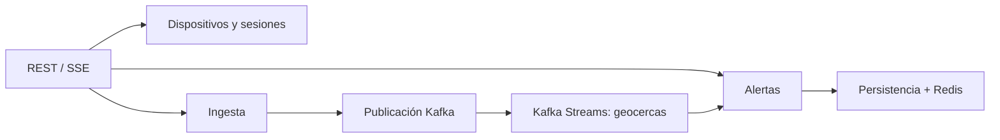

# ADR — Decisiones del MVP

| ID | Decisión | Motivo | Consecuencia |
|---|---|---|---|
| ADR-001 | Un colegio | Acotar el MVP | Configuración para un único colegio |
| ADR-002 | App Android instalada con Flutter y Dart e interfaz mínima | Seguimiento durante sesiones con pantalla bloqueada o al usar otra app | Requiere integrar Flutter con ubicación, permisos y ejecución Android, y validar en teléfonos reales |
| ADR-003 | Quarkus monolito modular | Menos despliegues | Separar módulos por dominio |
| ADR-004 | Kafka + Kafka Streams | Validar procesamiento por eventos | Broker externo al proceso Quarkus |
| ADR-005 | Redis para última posición | Lecturas rápidas | Caché recuperable desde PostgreSQL |
| ADR-006 | PostgreSQL para persistencia | Datos durables y consultas simples | Requiere backups |
| ADR-007 | Geocercas circulares | Evitar GIS complejo al inicio | No soporta polígonos |
| ADR-008 | SSE para dashboard | Flujo servidor → cliente sencillo | Reconexión y carga inicial por REST |
| ADR-009 | Docker Compose en VPS | Costo y simplicidad | Sin alta disponibilidad |
| ADR-010 | Sin Resilience4j inicialmente | Evitar complejidad redundante | Revisar SmallRye FT ante necesidades reales |
| ADR-011 | Next.js + PrimeReact para dashboard | Usar React y la familia de componentes Prime | Quarkus conserva la lógica de negocio y la API |
| ADR-012 | mapcn para mapas del dashboard | Componentes de mapas para React | Validar marcadores y zonas circulares en el diseño |
| ADR-013 | Flyway para migraciones PostgreSQL | Versionar cambios de esquema | Migraciones SQL revisables y verificadas antes del despliegue |
| ADR-014 | Google Stitch para pantallas y flujos | Revisar navegación y diseño antes de implementar | Dashboard basado en PrimeReact; Android con interfaz mínima |
| ADR-015 | Kivo como nombre del producto | Identidad acordada | Prefijo `kivo.` para los tópicos Kafka propuestos |
| ADR-016 | Spec central enlazada | Reunir acuerdos y aceptación sin duplicar todas las fuentes | [Spec aprobada](../../codebase/backend/docs/superpowers/specs/2026-11-08-kivo-mvp-design.md); P-01 a P-11 adoptadas como base, con refinamientos técnicos abiertos |
| ADR-017 | Código temporal de un solo uso para vinculación | Habilitación por administrador sin cuentas de estudiantes | Definir expiración, límites y protección del código antes de implementar |
| ADR-018 | Inicio/parada desde Android y cierre desde el colegio | Control local con supervisión escolar | Máximo configurable inicial de 8 horas; cierre remoto sujeto a comunicación |
| ADR-019 | SOS sin sesión, sin activar seguimiento | Permitir solicitar ayuda con monitoreo inactivo | Ubicación puntual opcional autorizada; no esperar GPS ni prometer atención |
| ADR-020 | Última posición pendiente y SOS durante desconexión | Evitar acumular historial local de ubicaciones | Descartar posición al cerrar sesión; límites/reintentos SOS pendientes |
| ADR-021 | Geocercas asignadas por dispositivo | Evitar aplicar todas las zonas a todos los teléfonos | Evaluación independiente por zona y asignación explícita |
| ADR-022 | Demo ficticia y retención acotada | Limitar datos del MVP | Ubicaciones 7 días; alertas/auditoría 30; mecanismo de borrado pendiente |
| ADR-023 | Java 25 LTS y Quarkus 3.40.1.1 LTS para el esqueleto | Instrucción del propietario y LTS vigente al generar | Sustituye Java 21; compilar y ejecutar contenedores con Java 25; [setup](../../codebase/README.md) |
| ADR-024 | Proyectos y Compose local dentro de `../../codebase` | Mantener juntos los esqueletos y su configuración | Backend y frontend arrancan sin infraestructura; PostgreSQL/Redis/Kafka disponibles mediante perfil `infra`, aún sin integrar |
| ADR-025 | Arquitectura hexagonal simplificada, por instrucción del propietario | Aislar reglas y dependencias externas sin imponer capas o interfaces redundantes | Organizar por funcionalidad; extraer puertos cuando permitan sustituir infraestructura o probar reglas; ver [guía](04-hexagonal-simplificada.md) |

## Módulos lógicos de Quarkus

## Integridad de eventos

- Cada posición incluye `eventId`, `deviceId`, `sessionId`, `recordedAt`, `latitude`, `longitude`, `accuracyMeters`; `sessionId` es la propuesta de contrato para asociar inequívocamente el evento a su sesión.
- Validar rangos de coordenadas, edad del evento, autenticación y sesión activa.
- Kafka usa `deviceId` como clave para preservar orden **dentro de una partición**.
- Idempotencia por `eventId`; no sobrescribir última posición con eventos anteriores.
- Los cambios de geocerca se publican como eventos de configuración o se recargan explícitamente; definir versión de configuración.
- Los eventos de alerta deben persistirse antes de confirmarse como gestionables.

Las ADR-016 a ADR-022 registran acuerdos del refinamiento. Las decisiones técnicas P-01 a P-11 se adoptaron mediante aprobación explícita de la spec por el propietario. Los refinamientos técnicos indicados siguen abiertos; los ejemplos y diagramas no acreditan implementación.
